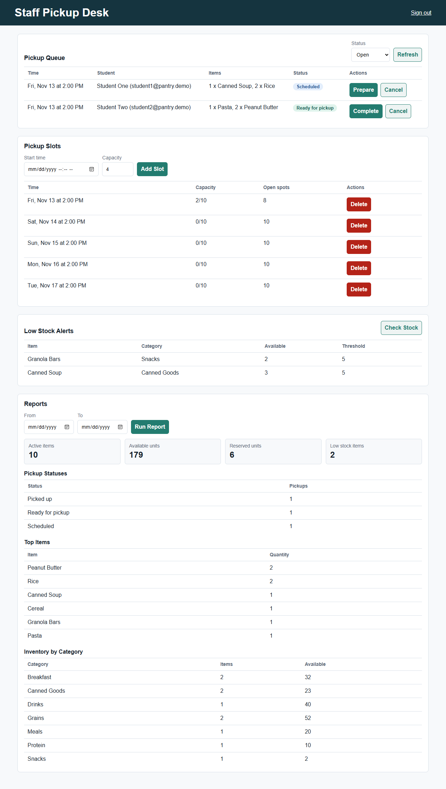
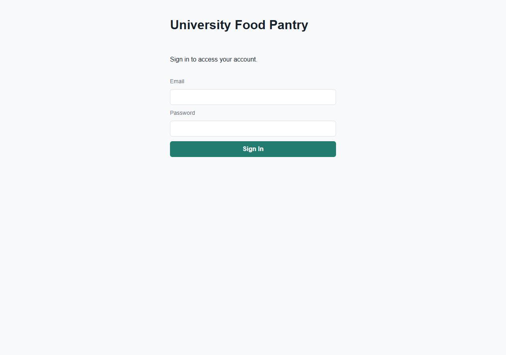
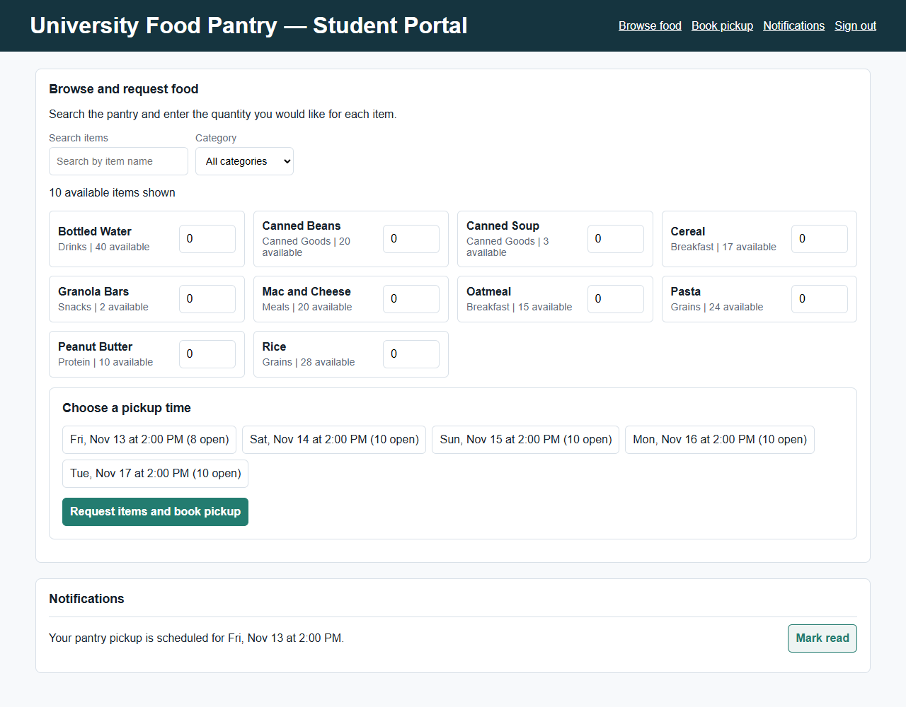

> **Draft status.** Organized by the Development Demo rubric (sections 1–10). Numbers come from runs on `main` on November 12, 2026. Sections 4, 6 and 7 were drafted from the automated tests for Gavin (QA lead) to review. Remove this note and every **TO ADD** before submitting.

**Live site:** https://university-food-pantry-cse-350.onrender.com

**Source code:** https://github.com/a0merr/University-Food-Pantry-CSE-350-

**Recording:** TO ADD (Andrew): recording link

# 1. Title

**Campus Food Pantry Platform**, Development Demo, November 13, 2026.

Team: Abdullah Saadawi, Mohamed Muse, Andrew Merritt, Gavin Marvelle.

# 2. Project overview

The Campus Food Pantry Platform is a web application that lets students request food from the campus pantry privately and book a pickup time, and lets pantry staff manage inventory, donations, pickups and usage reports. It addresses a social and welfare need: students facing food insecurity can get help without being seen asking for it, and staff can keep the shelves stocked and see how the pantry is used without collecting names.

There are two kinds of users:

- **Students** see what is in stock, request food, book a pickup time, and get notified when the order is scheduled, ready or cancelled, plus a reminder 24 hours before.
- **Pantry staff** run the pickup queue (prepare, complete, cancel), manage pickup times, get low-stock alerts, and run a usage report that shows counts only.

# 3. Present project status

| Req | Feature | Owner | Status |
|---|---|---|---|
| FR1 | Accounts and roles | Abdullah | Done |
| FR2 | Browse available items | Mohamed | Done |
| FR3 | Search and filter | Mohamed | Done |
| FR4 | Food requests | Mohamed | Done |
| FR5 | Pickup times | Andrew | Done |
| FR6 | Cancellations and notifications | Andrew | Done |
| FR7 | Inventory and donations | Abdullah | API done; no staff screen yet |
| FR8 | Pickup fulfillment | Andrew | Done |
| FR9 | Low-stock alerts | Andrew | Done |
| FR10 | Usage report | Andrew | Done |
| NFR1 | Security | Abdullah | Done |

The site is deployed on Render and redeploys automatically when `main` changes. All four team members' work is merged. The only gap is FR7's staff screen: adding items, changing stock and logging donations work through the API, but there is no page for them yet.

# 4. Test plan

## 4.1 Test approach

- **Unit testing:** every service, route and page script, with Node's built-in test runner (`node:test`). Page scripts run in jsdom.
- **Integration testing:** the real server and seed script run in a temporary folder, and tests go end to end through the API, including a full student-to-staff pickup.
- **Browser (end-to-end) testing:** Playwright drives the real pages in Chromium on desktop and phone sizes.
- **Accessibility testing:** axe-core scans every page state against WCAG 2.1 A and AA, plus keyboard-only and focus checks.
- **Load testing:** autocannon runs 9 scenarios with up to 50 users at once.
- **Regression testing:** the full suite is re-run after every fix.

## 4.2 Acceptance criteria

To move from testing to deployment:

| Criterion | Result |
|---|---|
| No critical or high-severity defects remain open | Met (4 open defects, all Medium or Low) |
| 100% of the 15 critical test cases pass | Met (15 of 15) |
| At least 95% of all automated tests pass | Met (218 of 221 unit and integration tests, 98.6%; 34 of 34 browser tests) |
| Every requirement is verified by at least one test case | Met (TC_01–TC_15, section 6) |
| 0 WCAG 2.1 AA accessibility violations | Met |
| Reads answer within 500 ms (p99) with 50 users | Met; one known slowdown during mass sign-ins (defect #20, Low) |

TO ADD (Gavin): confirm or adjust these criteria.

## 4.3 Test environment

- **Hardware:** team laptops (Windows 11 and macOS).
- **Runtime:** Node.js 22.13 or newer, npm.
- **Application:** Express 5, SQLite through Node's built-in `node:sqlite`, plain HTML, CSS and JavaScript.
- **Test tools:** `node:test`, jsdom, Playwright with Chromium (and Microsoft Edge for manual checks), axe-core, autocannon.
- **Live environment:** a Render web service; code and issues on GitHub.

## 4.4 Test data

- **Seed data** (`npm run seed`): one staff and three student demo accounts, ten items (Canned Soup and Granola Bars start below their low-stock thresholds), and five pickup times on the next five days.
- **Unit tests:** an in-memory database and a fake clock, with test users, items and pickup times created in each test.
- **Edge cases:** malformed JSON, 200 KB request bodies, HTML in names, daylight-saving dates, and full or past pickup times.
- **Browser and load tests:** a freshly seeded server in a temporary folder, so they never touch a real database.

## 4.5 Test cases per requirement

| Requirement | Test cases | Main automated tests (count) |
|---|---|---|
| FR1 Accounts and roles | TC_01, TC_02, TC_03 | Sign-in API (14), browser sign-in (9) |
| FR2 Browse items | TC_04 | Student filter (6), student page (8) |
| FR3 Search and filter | TC_05 | Student filter (6) |
| FR4 Food requests | TC_06 | Student page (8), real-server integration (12) |
| FR5 Pickup times | TC_07 | Pickup times (6), booking edge cases (31) |
| FR6 Cancel and notify | TC_08 | Notifications (3), browser staff desk (12) |
| FR7 Inventory and donations | TC_09 | Inventory API (8), inventory service (3) |
| FR8 Pickup fulfillment | TC_10 | Pickups (4), browser staff desk (12) |
| FR9 Low-stock alerts | TC_11 | Alerts (3), browser staff desk (12) |
| FR10 Usage report | TC_12 | Reports (3), browser staff desk (12) |
| NFR1 Security | TC_13, TC_14 | Security edge cases (20), server edge cases (8) |
| Accessibility and phones | TC_15 | Accessibility (10), phone layout (3) |
| **Total** | **15 test cases** | **221 unit and integration + 34 browser tests** |

Counts are the number of tests in each test file; some files cover more than one requirement.

## 4.6 Resource planning

- **Gavin Marvelle, QA lead:** test plan, test cases, the unit, integration, browser, accessibility and load test suites, GitHub Issues, and the test report.
- **Abdullah Saadawi, developer:** unit tests for sign-in, security and inventory; fixes defects in his requirements.
- **Mohamed Muse, developer:** unit tests for browsing and search; fixes defects in his requirements.
- **Andrew Merritt, project manager and developer:** unit tests for FR5, FR6 and FR8–FR10, end-to-end checks of the running server, bug fixes, reviews and merges.

## 4.7 Defect management

Defects are logged as **GitHub Issues** with steps to reproduce, the expected and actual result, and a screenshot or video. Each gets a severity (Critical, High, Medium or Low) and is assigned to the owner of that requirement. The workflow is **New → Open → In progress → Fixed → Verified → Closed**: a fix goes in through a pull request that says "Fixes #n", the tests are re-run and the flow is re-checked, and then the issue is closed. Known bugs that can't be fixed yet are written as `todo` tests, so they are tracked without failing the run.

# 5. Software implementation

## 5.1 How we implemented it

{ width=85% }

The application has four layers:

1. **Pages** (`public/`) are plain HTML, CSS and JavaScript modules with no framework or build step. They build the page with a safe DOM helper (never `innerHTML` with data) and send every request through one `api()` helper.
2. **API routes** (`src/routes/`, `src/auth/`) check the session and role. Every `POST`, `PATCH` and `DELETE` needs the `X-Requested-With: fetch` header and, when the browser sends one, a same-site `Origin`, which blocks cross-site request forgery.
3. **Services** (`src/services/`) hold the business rules. Each takes a database and a clock, so tests can pass an in-memory database and a fixed clock.
4. **Database** (`src/db.js`): SQLite tables for users, sessions, items, donations, pickup times, requests, notifications, an email outbox, low-stock alerts and settings. Stock changes run in transactions.

**Unit testing plan:** each developer writes `node:test` unit tests for their own code in `tests/unit/`, using the in-memory database and fake clock. `npm test` runs them all.

## 5.2 Programming language

JavaScript (Node.js 22 or newer, ES modules) on the server and in the browser, HTML and CSS for the pages, and SQL for the SQLite database.

## 5.3 Resources needed

- Laptops with Node.js 22.13 or newer and npm.
- A GitHub repository with write access for all four team members (pull requests and Issues).
- A Render account with deploy access (Abdullah) for the live site.
- Chromium and Microsoft Edge for browser testing.
- Application access levels: staff and student demo accounts, created by the seed script.

## 5.4 Implementation by requirement

**Accounts, roles and security (FR1, NFR1; Abdullah).** The sign-in page (`public/index.html`) signs in through `POST /api/auth/login` and sends staff to the staff page and students to the student page. Passwords are hashed with salted scrypt; only a SHA-256 hash of each session token is stored; session cookies are `HttpOnly` and `SameSite=Lax`, and `Secure` in production; login is limited to 5 failed attempts per 15 minutes; and every change needs the security header and a matching `Origin`. The seed script (`scripts/seed.js`) creates the demo accounts, items and pickup times. A sign-out link ends the session. TO ADD (Abdullah): describe your design in your own words.

{ width=55% }

**Browse, search and requests (FR2–FR4; Mohamed).** The student page (`public/student.html`) lists only active items that are in stock, with a search box (item name or category) and a category filter (`public/js/student-filter.js`). A student enters quantities, picks an open pickup time and submits. The page sends `POST /api/pickups` and shows the "scheduled" notification, which can be marked read. TO ADD (Mohamed): describe your design in your own words.

{ width=85% }

**Pickup times (FR5; Andrew).** Staff create pickup times with a capacity. Before a booking is saved, the server checks in one transaction that the student has no other open request, the time is in the future and not full, no item exceeds its per-visit limit (and no more than 8 different items), and there is enough stock. Then it saves the request and reserves the stock, so two students cannot both take the last unit.

**Cancellations and notifications (FR6; Andrew).** Cancelling gives the reserved stock back. Students get notifications when a pickup is scheduled, ready or cancelled, and a reminder for pickups in the next 24 hours (an hourly job that also runs at startup). Notifications are also written to an email outbox table. Staff can cancel from the queue.

**Pickup fulfillment (FR8; Andrew).** The staff queue shows the time, student, items and status. Staff mark a pickup ready (the student is notified) and then picked up (stock goes down). Pickups cannot skip a step.

**Low-stock alerts (FR9; Andrew).** After every booking, cancellation and completed pickup, and when staff click Check Stock, the server opens an alert for each item at or below its threshold, and closes it when the item is restocked.

**Usage report (FR10; Andrew).** For a date range: pickups by status, the top ten items (cancelled requests excluded) and stock by category. Counts only, never names or emails; a test checks this.

**Inventory and donations (FR7; Abdullah).** `POST /api/items`, `PATCH /api/items/:id` and `POST /api/donations` add items, change stock and log donations (staff only). There is no staff screen yet, and new items can't yet be given a threshold, limits or tags (open defects #17–#19). TO ADD (Abdullah).

## 5.5 AI-generated code

The rubric asks for at least 10% AI-generated code and for it to be mentioned. Every AI-generated or AI-assisted file and change is listed by tool in `docs/AI_USAGE.md`.

| Source | Lines | Share |
|---|---:|---:|
| Claude Code starter files (database schema, helpers, password hashing, browser helpers) | 360 | 4.6% |
| Claude Code, Andrew: bug fixes, shared stylesheet, staff cancel button, sign-out link, staff account check, QA bug fixes | 436 | 5.6% |
| Claude Code, Gavin: QA test suite (both commits co-authored by Claude Opus 5.5) | 3,700 | 47.7% |
| ChatGPT-assisted, Abdullah (inventory and security code; whole files counted) | 544 | 7.0% |
| **All AI-generated or AI-assisted** | **5,040** | **65.0%** |

Counted over 7,756 lines of `.js`, `.html` and `.css`, including tests. Without the tests, the application code is 2,898 lines, of which 1,110 (38.3%) are AI-generated or AI-assisted. Both figures are upper bounds, because the ChatGPT row counts whole files.

## 5.6 Bugs raised by testing and how we resolved them

All of these are closed. "QA" means found by Gavin's tests or Issues; "E2E" means found by the end-to-end runs against a running server.

| # | Defect | Found by | Severity | How we resolved it |
|---|---|---|---|---|
| 1 | Login on Render: every `POST` rejected with 403 behind the HTTPS proxy | E2E | Critical | Trust one proxy hop on Render (PR #12) |
| 2 | Live site ran on UTC: pickup-time checks, reminders and report dates 5 hours off | QA | High | Server and seed default to Eastern time (PR #23) |
| 3 | Issue #11: home page returned 404 | QA | High | Sign-in page (PR #14) |
| 4 | Issue #18: student sign-in led to a 404 | QA | High | Student page (PR #22) |
| 5 | Fresh clone: `npm start` crashed with no `data/` folder | E2E | High | Server creates the folder (PR #12) |
| 6 | Issue #19: after a student signed in on another tab, staff actions failed | QA | Medium | Staff page notices the account switch and says so (PR #20) |
| 7 | Usage report counted cancelled requests | E2E | Medium | Cancelled requests excluded, with a test (PR #12) |
| 8 | Deleting a pickup time with past pickups returned 500 | E2E | Medium | Returns 409 with a clear message, with a test (PR #12) |
| 9 | A pickup time could be edited into the past | E2E | Medium | Rejected with 400, with a test (PR #12) |
| 10 | Reminders waited an hour after a restart | E2E | Low | Also run at startup (PR #12) |
| 11 | Malformed JSON returned 500 | E2E | Low | Returns 400 (PR #12) |
| 12 | Unknown API routes returned an HTML page | QA | Low | JSON 404 (PR #23) |
| 13 | Request body over 100 KB returned 500 | QA | Low | Returns 413 (PR #23) |
| 14 | 2:30 AM on daylight-saving day saved as 3:30 | QA | Low | Rejected, with a test (PR #23) |
| 15 | Staff queue date filter left out a 23:59:59 pickup | QA | Low | Included, with a test (PR #23) |
| 16 | A failed sign-out left an unhandled error in the browser | QA | Low | Error caught (PR #24) |

## 5.7 Deployment and source code

The app runs on Render as a Node web service and redeploys automatically when `main` changes. Render sets the `RENDER` environment variable, which makes the server trust Render's HTTPS proxy. The database is a SQLite file on the server's disk, which Render resets on redeploys, so the demo relies on the seed data. TO ADD (Abdullah): the deploy steps you used.

All source files are on GitHub: https://github.com/a0merr/University-Food-Pantry-CSE-350-

# 6. Test scripts

Each test case was verified by the automated tests named under "Verified by", run on November 12, 2026. Browser: Chromium (Playwright); manual checks in Microsoft Edge. Demo passwords come from the seed script and are not repeated here.

**TC_01 · FR1: Staff sign-in.** Status: Pass. Test data: `staff@pantry.demo`. Verified by: browser test "staff sign in and land on the staff page".

| Test step | Expected result |
|---|---|
| Go to the live site | The sign-in page shows Email and Password fields |
| Enter `staff@pantry.demo` | The Email field accepts the address |
| Enter the password | The password is accepted and shown as dots |
| Click Sign In | The staff pickup desk (`/staff.html`) opens |

**TC_02 · FR1: Student sign-in.** Status: Pass. Test data: `student1@pantry.demo`. Verified by: browser test "students sign in and land on a working student page".

| Test step | Expected result |
|---|---|
| Go to the live site and enter the student's email and password | Both fields accept the input |
| Click Sign In | The student portal (`/student.html`) opens and lists items |

**TC_03 · FR1: Wrong password.** Status: Pass. Test data: `student1@pantry.demo` with a wrong password. Verified by: browser test "a wrong password shows an error and stays on the page".

| Test step | Expected result |
|---|---|
| Enter the email and a wrong password, click Sign In | "Incorrect email or password." appears and the sign-in page stays open |

**TC_04 · FR2: Only in-stock items are listed.** Status: Pass. Test data: seed items, plus one item with 0 available and one inactive item. Verified by: unit test "FR2 lists only active items with stock" and student page tests.

| Test step | Expected result |
|---|---|
| Sign in as a student | The item list shows each active item with stock above 0, and its category and amount available |
| Look for the out-of-stock or inactive item | It is not listed |

**TC_05 · FR3: Search and filter.** Status: Pass. Test data: seed items. Verified by: student filter unit tests (6).

| Test step | Expected result |
|---|---|
| Type "rice" in Search | Only Rice is listed |
| Type "can" in Search | Canned Beans and Canned Soup are listed |
| Clear Search and pick a category | Only that category's items are listed |

**TC_06 · FR4: Request food and book a pickup.** Status: Pass. Test data: `student1@pantry.demo`, Rice quantity 2, an open pickup time. Verified by: student page test "student can schedule a pickup" and the real-server end-to-end test.

| Test step | Expected result |
|---|---|
| Sign in as student1 | The student portal lists in-stock items |
| Type "rice" in Search | Only Rice is listed |
| Enter 2 for Rice and pick a pickup time | The chosen time is highlighted |
| Click "Request items and book pickup" | "Pickup scheduled" appears, and a notification gives the pickup time |

**TC_07 · FR5: Past or full pickup times are refused.** Status: Pass. Test data: a pickup time in the past; a pickup time at capacity. Verified by: booking edge-case unit tests and the end-to-end API run.

| Test step | Expected result |
|---|---|
| Try to book a pickup time that has passed | Refused: "Pickup slot must be in the future." |
| Try to book a pickup time that is full | Refused: "Pickup slot is full." |
| Try to book a second pickup while one is open | Refused: "You already have an open pickup request." |

**TC_08 · FR6: Cancel releases stock and notifies the student.** Status: Pass. Test data: a booked pickup. Verified by: browser test "staff cancel a pickup; stock is released and the student is notified".

| Test step | Expected result |
|---|---|
| As staff, click Cancel on a pickup in the queue | "Pickup cancelled. The student was notified." The pickup leaves the queue |
| Check the item's stock | The reserved amount is back in stock |
| Sign in as that student | A "cancelled" notification is shown |

**TC_09 · FR7: Staff manage inventory and donations.** Status: Pass. Test data: a new item; a donation. Verified by: inventory API unit tests (8).

| Test step | Expected result |
|---|---|
| As staff, add an item with a name, category and quantity | The item is created and listed |
| Change the item's quantity | The new quantity is saved |
| Log a donation for the item | The stock goes up and the donation is recorded against the staff member |
| Try the same as a student | Refused (403) |

**TC_10 · FR8: Prepare, then complete a pickup.** Status: Pass. Test data: a booked pickup. Verified by: browser test "staff prepare then complete a pickup; the student is notified".

| Test step | Expected result |
|---|---|
| As staff, click Prepare | The status changes to "Ready for pickup" and the student is notified |
| Click Complete | The pickup leaves the open queue and the stock goes down |

**TC_11 · FR9: Check Stock lists low-stock items.** Status: Pass. Test data: seed data (Canned Soup and Granola Bars below threshold). Verified by: browser test "Check Stock lists the seeded low-stock items".

| Test step | Expected result |
|---|---|
| As staff, click Check Stock | "Low stock alerts refreshed." Canned Soup and Granola Bars are listed with their available amount and threshold |

**TC_12 · FR10: Usage report.** Status: Pass. Test data: seed data with bookings. Verified by: browser test "the usage report shows inventory totals and runs for a date range" and report unit tests.

| Test step | Expected result |
|---|---|
| As staff, pick From and To dates and click Run Report | Totals, pickups by status, top items and stock by category are shown |
| Read the report | No student names or emails appear |

**TC_13 · NFR1: Students cannot see staff data.** Status: Pass. Test data: a student account. Verified by: browser test "a student who opens the staff page sees access errors, not staff data".

| Test step | Expected result |
|---|---|
| Sign in as a student and open `/staff.html` | Staff data does not load; the page shows access errors |

**TC_14 · NFR1: Cross-site requests are refused.** Status: Pass. Test data: a change request without the security header, and one from another site. Verified by: integration tests "API writes without the X-Requested-With header are refused" and "cross-origin and malformed Origin headers are refused".

| Test step | Expected result |
|---|---|
| Send a booking without the `X-Requested-With` header | Refused (403) |
| Send a booking with another site's `Origin` | Refused (403) |

**TC_15 · Accessibility and phones.** Status: Pass. Test data: every page state. Verified by: browser accessibility tests (10) and phone layout tests (3).

| Test step | Expected result |
|---|---|
| Scan each page with axe-core (WCAG 2.1 A and AA) | 0 violations |
| Sign in and prepare a pickup using only the keyboard | Both work, with a visible focus indicator |
| Open the pages at phone width | No sideways scrolling; buttons can be tapped |

# 7. Test report

## 7.1 Planned vs executed

| Test set | Planned | Executed | Passed | Failed | Notes |
|---|---:|---:|---:|---:|---|
| Test cases (section 6) | 15 | 15 | 15 | 0 | |
| Unit and integration tests (`npm test`) | 221 | 221 | 218 | 0 | 3 `todo` tests record open FR7 defects #17–#19 |
| Browser and accessibility tests (`npm run test:e2e`) | 34 | 34 | 34 | 0 | Desktop and phone |
| Load scenarios (`npm run test:perf`) | 9 | 9 | 8 | 0 | 1 known issue (defect #20) |

## 7.2 Load test results

Five seconds per scenario, run on November 12, 2026.

| Scenario | Users | Requests/s | p50 ms | p99 ms | Result |
|---|---:|---:|---:|---:|---|
| Health check | 50 | 20,958 | 2 | 4 | Pass |
| Browse items (public) | 50 | 9,166 | 5 | 7 | Pass |
| Static sign-in page | 50 | 3,560 | 13 | 20 | Pass |
| Staff pickup queue | 50 | 7,113 | 6 | 10 | Pass |
| Staff pickup times | 50 | 5,960 | 8 | 12 | Pass |
| Staff usage report | 50 | 3,977 | 12 | 18 | Pass |
| Staff low-stock check (write) | 20 | 5,556 | 3 | 9 | Pass |
| Sign in (scrypt hashing) | 10 | 37 | 270 | 303 | Pass |
| Browse items during 10 sign-ins at once | 60 | 96 | 550 | 582 | Known issue: p99 over 500 ms |

## 7.3 Defects

20 defects found: **16 closed, 4 open.** No critical or high-severity defects are open. The 16 closed defects are listed in section 5.6. Open defects:

| # | Defect | Severity | Status | Owner |
|---|---|---|---|---|
| 17 | New items can't be given a low-stock threshold through the API | Medium | Open | Abdullah |
| 18 | New items can't be given a per-visit limit or dietary tags | Medium | Open | Abdullah |
| 19 | Items can't be retired (hidden from students) | Medium | Open | Abdullah |
| 20 | Browsing slows (p99 582 ms) while 10 people sign in at once, because password hashing blocks the server | Low | Open | Team |

TO ADD (Gavin): confirm the severities.

# 8. Implementation milestones

| Milestone | Planned | Actual | Status |
|---|---|---|---|
| Tech stack chosen | Tue, Nov 3 | Wed, Nov 4; changed to Express and SQLite Nov 9 | 1 day late |
| Repository and starter code | Tue, Nov 3 | Mon, Nov 9 | Late |
| Core features merged | Mon, Nov 9 | Tue, Nov 10 (FR1, FR5–FR10, FR7) | 1 day late |
| Sign-in and student pages | Mon, Nov 9 | Thu, Nov 12 | 3 days late |
| Testing and bug fixes | Tue–Wed, Nov 10–11 | Thu, Nov 12 | 1 day late |
| Deployed live on Render | Not in the plan | Thu, Nov 12 | Done |
| Slides and recording | Wed–Thu, Nov 11–12 | Thu–Fri, Nov 12–13 | 1 day late |
| Submit | Fri, Nov 13 | Fri, Nov 13 | On track |

We fell behind early because the repository went up late, then caught up by building and testing in parallel on November 12. We are on track to submit on time.

# 9. Team assignments and responsibilities

- **Andrew Merritt, project manager and developer.** Planned the sprint and kept the timeline, coordinated the team, and reviewed and merged pull requests. Built pickup times (FR5), cancellations and notifications (FR6), pickup fulfillment (FR8), low-stock alerts (FR9) and the usage report (FR10), plus the staff page and shared styles. Fixed bugs found in testing and put together the deck and this report.
- **Abdullah Saadawi, developer.** Set up the Express server. Built accounts, sign-in and roles (FR1) and the security measures (NFR1), the inventory and donations API (FR7), the sign-in page and the demo seed data. Deployed the site on Render.
- **Mohamed Muse, developer.** Built the student portal (FR2–FR4): browsing in-stock items, search and category filtering, requesting food and booking a pickup, and showing notifications. Wrote unit tests for the filters.
- **Gavin Marvelle, QA lead.** Wrote the test plan and test cases. Built the unit, integration, browser, accessibility and load test suites (255 automated tests). Logged Issues #11, #18 and #19 and wrote the test report.

**Lessons learned.** TO ADD (team): one line per person.

# 10. Ethical guidelines

We followed the ethical guidelines for computing practice:

- **Respect for ownership.** We use open-source packages (Express, Playwright, axe-core, autocannon, jsdom) under their licenses, as listed in `package.json`. Our code is MIT-licensed.
- **Avoiding plagiarism.** Every AI-generated file and change is credited by tool (Claude Code by Anthropic, ChatGPT by OpenAI) in `docs/AI_USAGE.md`, and the AI starter files carry a marker comment. Packages and tools are listed in the references below.
- **Confidentiality.** Passwords and session tokens are stored only as hashes. The repository holds demo accounts only, with no real student data, and the database file and `.env` are kept out of git. The usage report shows counts, never names or emails.
- **Promoting diversity and equity.** Requests are private, which reduces the stigma of asking for food. Every page passes WCAG 2.1 AA checks with 0 violations, signing in and running the staff queue were tested with the keyboard alone, and the pages work on phones as well as laptops.

# References

- Express 5: https://expressjs.com/
- Node.js built-in SQLite (`node:sqlite`) and test runner (`node:test`): https://nodejs.org/
- Playwright: https://playwright.dev/
- axe-core: https://github.com/dequelabs/axe-core
- autocannon: https://github.com/mcollina/autocannon
- jsdom: https://github.com/jsdom/jsdom
- Render: https://render.com/
- AI tools: Claude Code (Anthropic) and ChatGPT (OpenAI); see `docs/AI_USAGE.md`.

# Appendix: running the project

1. Install Node.js 22.13 or newer.
2. `git clone https://github.com/a0merr/University-Food-Pantry-CSE-350-.git`, then `npm install`.
3. `npm run seed` to load demo data, then `npm start` and open http://localhost:3000.
4. `npm test` runs unit and integration tests; `npx playwright install chromium` once, then `npm run test:e2e` for browser tests; `npm run test:perf` for the load test.
